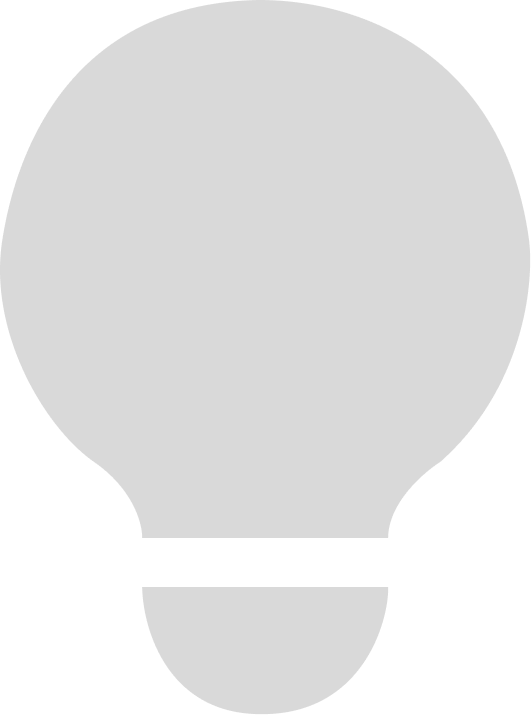

<div align="center">
  
  <h1>Photon</h1>
  <p>Save, load, share and preview Roblox lighting presets, right inside Studio.</p>
</div>

Photon keeps a library of lighting presets that follows you between places. Preview any preset rendered by Roblox itself, load it into your place, insert it for scripts to use, or share it as a short code.

Everything runs inside Studio. There's no backend or account.

## Install

Install Photon from the Creator Store, or download `Photon.rbxm` from the [latest release](https://github.com/twistedsignal/photon/releases/latest), put it in your Studio Plugins folder (Plugins → Plugins Folder) and restart Studio.

To build it yourself, install [Rokit](https://github.com/rojo-rbx/rokit), then:

```sh
rokit install
wally install
./scripts/build.bash   # writes build/Photon.rbxm and build/PhotonLoader.rbxm
```

## Use Photon

Click **Photon** in the Plugins tab and pick a preset. The bar at the bottom acts on it:

The **Insert loader** button in the header adds or updates `ReplicatedStorage.Photon.Loader` without selecting a preset.

- **Load** applies the preset to your place's Lighting. Ctrl+Z undoes it.
- **Insert** adds the preset to `ReplicatedStorage.Photon.Presets`, with the loader module next to it, so your scripts can load it.
- The icons on the right **save** your current Studio lighting as a new preset, **import** a code someone shared, and **export** the selected preset as a code, such as `PHEB...`.

Each card's **•••** menu also has **Retake preview**. Your own presets add **Move to folder**, **Update from Studio** (replaces the preset with your current lighting, after asking first), **Rename** and **Delete**.

### Folders

Presets are grouped in collapsible folders. **Built-in** holds the 14 presets that come with Photon: Roblox Default, Clear Day, Golden Hour, Sunset, Overcast, Foggy Morning, Night, Moonlit, Neon City, Horror, Desert Heat, Arctic, Underwater and Cartoon. Create your own folders with the folder button next to the search box, then rename or delete them from their **•••** menu. Presets in a deleted folder move to **Unsorted**.

Your presets and folders are stored with your Studio settings, so they're there in every place you open.

### Previews

When you pick a preset, Photon shows a picture of it taken by Roblox itself, so you see exactly how the lighting looks: shadows, atmosphere, sky, clouds, bloom and color grading included. To take it, Photon:

1. starts a change-history recording,
2. applies the preset and builds a small test scene far from your map (a baseplate with material spheres, a figure, a wall and a pillar),
3. points the camera at it and takes screenshots until the picture stops changing, since Roblox takes a few seconds to finish updating lighting,
4. cancels the recording, which puts your lighting back and leaves nothing in the undo history.

Your camera and selection are restored afterwards. While this happens, Studio's viewport shows the preset for a few seconds. Previews are saved, so each preset is only previewed once. Retake one from the preview's refresh button or the card's menu.

### Preview settings

Settings has controls for camera distance, field of view, orbit and elevation, floor color, grid, reference props and capture settle time. Turn off **Automatic previews** to capture only when you click refresh.

To use your own preview model, select a Model or part in Explorer and click **Use selection** in Settings. Photon saves a copy with Studio's native instance serializer, including meshes, unions and textures. The copy stays available across places and Studio restarts. Scripts are removed and parts are anchored. **Use default** restores the built-in scene.

**Model size** fits the longest side to a chosen number of studs; **Model rotation** turns it on the baseplate. Settings also persist across places. Changing the scene or camera invalidates previews taken with the previous settings.

### What a preset contains

Photon saves everything a preset needs. `Lighting.Technology` is the exception: scripts can't read it.

- **Lighting**: Ambient, Brightness, both ColorShifts, environment diffuse and specular scale, GlobalShadows, OutdoorAmbient, ShadowSoftness, ClockTime, GeographicLatitude, ExposureCompensation, fog, LightingStyle and PrioritizeLightingQuality.
- **Instances**: Sky, Atmosphere, Bloom, Blur, ColorCorrection, ColorGrading, DepthOfField and SunRays effects, plus `Terrain.Clouds`.

## Load presets from scripts

**Insert** creates this:

```
ReplicatedStorage
└── Photon
    ├── Loader         (ModuleScript)
    └── Presets
        └── Golden Hour
            ├── Ambient, Brightness, ClockTime, ...   (one value per Lighting property)
            └── child
                └── Sky, Atmosphere, ColorCorrection, ...
```

Preset folders are ordinary instances, so you can edit the values and effects in Studio. Delete a value and loading leaves that property alone.

```lua
local Photon = require(game.ReplicatedStorage.Photon.Loader)

Photon.load("Golden Hour")                    -- instant
Photon.load("Night", TweenInfo.new(3))        -- tween over 3 seconds
Photon.load("PHEBAAAA...")                    -- a share code works too
Photon.load(workspace.SomePresetFolder)       -- or any preset folder

print(Photon.list())                          -- names in the Presets folder
local current = Photon.capture()              -- the current lighting as data
print(Photon.encode(current))                 -- ...and as a share code
```

Loading from a server Script changes lighting for everyone. Loading from a LocalScript changes it for that player only.

When tweening, numbers and colors on Lighting and on matching effects animate. ClockTime takes the short way around midnight. Sky textures, toggles and enum values switch at the start. Effects the preset doesn't have are removed. Photon never removes anything else under Lighting, such as scripts or lights.

The loader is also attached to each release as `PhotonLoader.rbxm` if you want it without the plugin.

## Lighting codes

Codes are kept short by packing bits instead of writing text:

- A code is `PH` followed by base64url.
- Inside are a 4-bit format version, then every Lighting property, then each effect.
- Each property starts with one bit that says whether it differs from Roblox's default. Unchanged properties cost that single bit.
- Changed numbers are rounded to a fixed step (0.01 for Brightness, one minute for ClockTime) and packed into as few bits as their range needs.
- Colors take 24 bits and asset IDs are varints.

Default lighting encodes to `PHEAAAAA`. The built-in presets encode to 46–96 characters.

Because of the rounding, an imported preset can differ from the original by less than one step. Presets you save yourself keep full precision.

## Development

```sh
./scripts/dev.bash    # rebuilds Photon-dev.rbxm into your Plugins folder on every change
./scripts/test.bash   # selene and the lune tests
```

Dev builds (any plugin file with `dev` in its name) expose `shared.PhotonDev` for testing from the command bar. `scripts/bundle.py` bundles modules into one chunk that you can paste into the command bar.

[`RELEASING.md`](RELEASING.md) lists the steps for a release, including the Roblox plugin description to update each time.

## License

MIT © Twisted Signal. Lucide icons are under the [ISC license](third_party/lucide-LICENSE).
